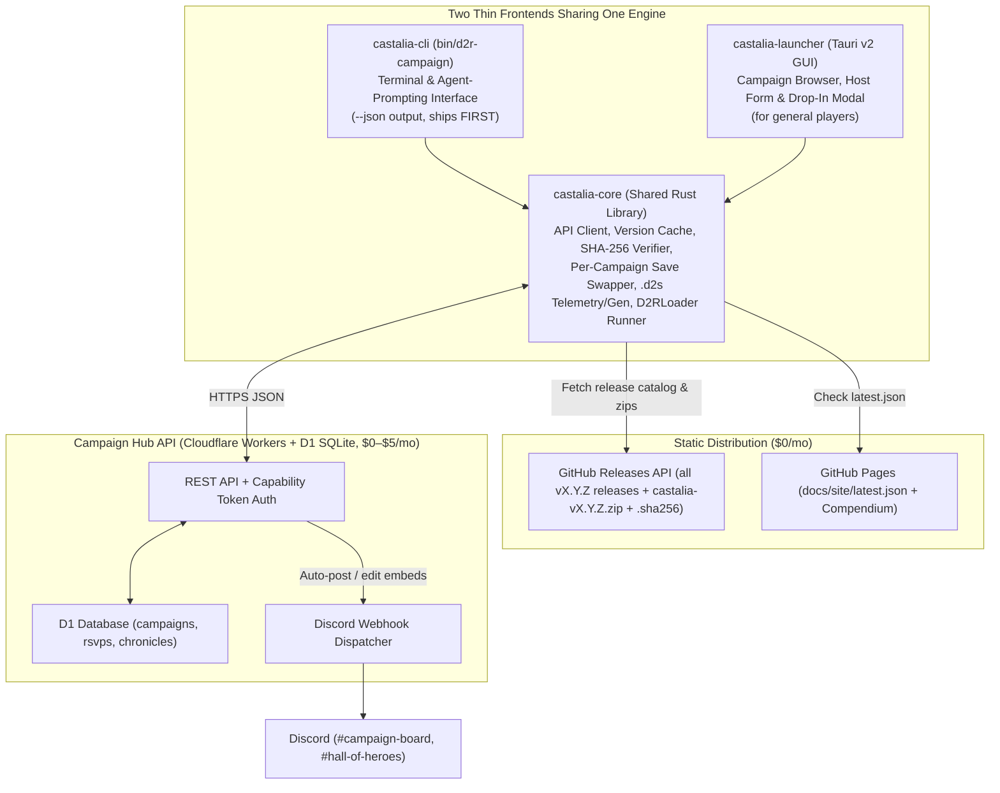

# Castalia Launcher, CLI & Campaign Hub — Technical Specification & Status (v3)

> **Status:** **MVP Built & E2E Verified** on `feat/campaign-launcher` (Python 3.12 zero-dependency MVP + Cloudflare Workers `worker/` + native MSVC `castalia-autohost.dll` plugin; ready for Cloudflare deploy & Windows packaging).  
> **Goal:** Replace manual `.zip` extraction, version checks, save juggling, and Discord copy/pasting with a shared engine exposed as **both** a tight agent-friendly CLI (`bin/d2r-campaign`) and a cross-platform desktop launcher (`bin/d2r-launcher`), backed by a minimal Campaign API.

---

## 1. System Architecture Overview



### Workspace Layout (Zero Logic Duplication)
```text
castalia-hub/
├── crates/
│   ├── castalia-core/        # 100% of local & API logic (shared by CLI and GUI)
│   │   ├── api.rs            # Campaign Hub REST client + tokens.json store
│   │   ├── versions.rs       # GitHub Releases fetcher, SHA-256 verifier, versions/ cache
│   │   ├── profiles.rs       # Crash-safe per-campaign save swapper (solo / campaign-<id>)
│   │   ├── d2s.rs            # .d2s parser (telemetry/build label) + Starter-Kit generator
│   │   └── runner.rs         # D2R / D2RLoader detection, spawn & post-exit sync hook
│   ├── castalia-cli/         # Tight CLI binary (`bin/d2r-campaign`) — built & dogfooded FIRST
│   └── castalia-launcher/    # Tauri v2 Desktop GUI — thin UI over `castalia-core`
└── worker/                   # Cloudflare Workers + D1 REST API + Discord Webhooks
```

**Why CLI-First Wins:** Both frontends share the exact same `<launcher_data>/` directory (`config.json`, `tokens.json`, `versions/`, `profiles/`, `active_profile.json`). You can build `worker/` + `castalia-core` + `bin/d2r-campaign` **first**, host real weekly co-op sessions from your terminal (and via Antigravity agent prompting), battle-test the save swapper and `.d2s` telemetry, and then wrap `castalia-core` in the Tauri v2 GUI for general players with zero rewritten logic.

### Core Stack Choices
* **Desktop Client:** **Tauri v2** (Rust backend + lightweight HTML/JS frontend) → ~8 MB native binary for Windows (`.exe`/`.msi`) and Linux (`AppImage`), native filesystem/zip/SHA-256/process spawning.
* **Backend API:** **Cloudflare Workers + D1 (SQLite)** (or Fly.io + SQLite) → free tier easily covers thousands of players, zero server maintenance.
* **Binary Mod Hosting:** **GitHub Releases** — provides both the list of all historical `vX.Y.Z` versions and direct `.zip`/`.sha256` downloads.

---

## 2. Locked MVP Design Decisions

| Area | MVP Decision | Deferred to Backburner (Phase 2) |
| :--- | :--- | :--- |
| **1. User Identity** | **Local Capability Tokens** (`host_token` / `rsvp_token` stored in local launcher config JSON + display name). Zero login screens, maximum dev velocity. | Discord OAuth2 (`identify` scope), multi-device Host ownership, Discord `@mention` pings, `OPEN_HOSTING` allowlist. |
| **2. Visibility** | **Public campaigns only** (all campaigns appear in the Launcher Browser and Discord `#campaign-board`). | Unlisted / invite-code-only private campaigns. |
| **3. Save Isolation** | **Per-Campaign Save Swapping** — launcher isolates `.d2s` & shared stash files per campaign profile and swaps them seamlessly into `Saved Games/.../mods/castalia/`. | Cloud `.d2s` save vault sync. |
| **4. D2RLoader** | **Detect existing install** (`D2RLoader.exe` + `d2rloader.toml`), display readiness badge, and link to `d2rloader.net` if missing. | Auto-downloading / bundling D2RLoader inside the launcher. |
| **5. Mod Versioning** | **Strict version pinning + historical versions supported.** Campaigns stay pinned until Host explicitly upgrades; Hosts can create campaigns on any past GitHub Release version. | Automatic patch-follow toggle. |

---

## 3. Identity & Token Security (MVP)

* **No User Accounts Required:** Browsing campaigns, syncing Castalia, generating `.d2s` characters, and launching solo/co-op require zero sign-in.
* **Capability Tokens:**
  * `POST /api/campaigns` generates a cryptographically random `host_token`, stores only `SHA-256(host_token)` in D1, and returns the raw `host_token` once to the Host's launcher (saved in `<launcher_data>/tokens.json`).
  * `POST /api/campaigns/:id/rsvp` generates a random `rsvp_token`, stores `SHA-256(rsvp_token)` in D1, and returns it to the player's launcher.
  * Mutating endpoints (`PATCH`, `go-live`, `end-session`, `complete`, `DELETE rsvp`) authenticate via `Authorization: Bearer <token>`.
  * `live_join_info` (Host's D2RLoader Game ID) is returned **only** when a valid `host_token` or confirmed `rsvp_token` is presented and `status == 'live'`.
* **Clean Upgrade Path to Discord OAuth2:** Adding nullable `host_discord_id` / `player_discord_id` columns later lets Phase 2 layer Discord OAuth2 on top without breaking existing campaigns.

---

## 4. Database Schema (SQLite / Cloudflare D1)

```sql
-- Core campaign state (single source of truth for schedule, pinned version & progress)
CREATE TABLE campaigns (
  id                TEXT PRIMARY KEY,          -- short slug e.g. "thu-pilgrimage-4k9a"
  host_name         TEXT NOT NULL,             -- display name / Discord handle
  host_token_hash   TEXT NOT NULL,             -- SHA-256 of secret host_token
  title             TEXT NOT NULL,
  description       TEXT NOT NULL,
  ruleset           TEXT NOT NULL,             -- "standard" | "expedition" | "three_lives" | "hardcore" | "oneshot"
  castalia_version  TEXT NOT NULL,             -- pinned SemVer e.g. "0.4.2" (any published GitHub Release)
  current_level     INTEGER NOT NULL DEFAULT 1,
  current_wp        TEXT NOT NULL DEFAULT 'a1n',
  max_seats         INTEGER NOT NULL DEFAULT 5,
  schedule_text     TEXT NOT NULL,             -- e.g. "Thursdays 8–10 PM EST"
  recurrence_days   INTEGER DEFAULT 7,         -- auto-advance next_session_utc after host exits (NULL for one-shots)
  next_session_utc  TEXT,                      -- ISO-8601 UTC (rendered in viewer's local TZ)
  status            TEXT NOT NULL DEFAULT 'recruiting', -- "recruiting" | "active" | "live" | "completed" | "archived"
  live_join_info    TEXT,                      -- D2RLoader Game ID (ONLY returned to Host / confirmed RSVP when live)
  discord_msg_id    TEXT,                      -- Discord webhook message ID for in-place edits
  created_at        TEXT NOT NULL,
  updated_at        TEXT NOT NULL
);

-- Per-session RSVPs (returning regulars & drop-ins)
CREATE TABLE rsvps (
  id                TEXT PRIMARY KEY,
  campaign_id       TEXT NOT NULL REFERENCES campaigns(id) ON DELETE CASCADE,
  session_utc       TEXT NOT NULL,
  player_name       TEXT NOT NULL,
  rsvp_token_hash   TEXT NOT NULL,             -- SHA-256 of secret rsvp_token
  join_mode         TEXT NOT NULL,             -- "returning" | "drop_in"
  char_name         TEXT NOT NULL,
  char_class        TEXT NOT NULL,             -- "pal" | "bar" | "ass" | "sor" | "ama" | "dru" | "nec"
  char_level        INTEGER NOT NULL DEFAULT 1,-- auto-updated from .d2s on D2RLoader exit
  char_wp           TEXT NOT NULL DEFAULT 'a1n',-- highest unlocked Act/WP parsed from .d2s
  build_summary     TEXT NOT NULL DEFAULT '',  -- auto-derived from .d2s top invested skills e.g. "Vengeance / Salvation"
  status            TEXT NOT NULL DEFAULT 'confirmed', -- "confirmed" | "waitlist" | "cancelled"
  created_at        TEXT NOT NULL
);

-- Completed campaign records (Hall of Heroes)
CREATE TABLE chronicles (
  id                TEXT PRIMARY KEY,
  campaign_id       TEXT NOT NULL REFERENCES campaigns(id),
  completed_at      TEXT NOT NULL,
  sessions_played   INTEGER NOT NULL,
  death_count       INTEGER NOT NULL DEFAULT 0,
  party_roster_json TEXT NOT NULL,
  summary           TEXT NOT NULL,
  screenshot_url    TEXT
);
```

---

## 5. REST API Contract

| Method | Endpoint | Auth | Purpose |
| :--- | :--- | :---: | :--- |
| `GET` | `/api/campaigns` | Public | List active/recruiting public campaigns (excludes `live_join_info` & token hashes). |
| `GET` | `/api/campaigns/:id` | Optional Bearer | Campaign details + current session RSVP roster. Includes `live_join_info` **only** if valid `host_token` or confirmed `rsvp_token` and `status == 'live'`. |
| `POST` | `/api/campaigns` | Public | Create public campaign → returns `{ campaign, host_token }` + posts embed to Discord `#campaign-board`. |
| `PATCH` | `/api/campaigns/:id` | `host_token` | Update Level, Waypoint, pinned `castalia_version`, next session time, ruleset, or status → edits Discord embed in-place. |
| `POST` | `/api/campaigns/:id/go-live` | `host_token` | Sets `status = 'live'`, stores `live_join_info`, posts session-start notice to Discord. |
| `POST` | `/api/campaigns/:id/end-session` | `host_token` | Clears `live_join_info`, sets `status = 'active'`, updates `current_level`, `current_wp`, and `next_session_utc`. |
| `POST` | `/api/campaigns/:id/rsvp` | Public | Claim an open seat (`returning` or `drop_in`, `char_name`, `char_class`) → returns `{ rsvp, rsvp_token }`. |
| `PATCH` | `/api/campaigns/:id/rsvp/:rsvp_id/telemetry` | `rsvp_token` or `host_token` | Auto-called by the launcher on `D2RLoader.exe` exit: updates `char_name`, `char_class`, `char_level`, `char_wp`, and `build_summary` from the local `.d2s` save. |
| `DELETE` | `/api/campaigns/:id/rsvp/:rsvp_id` | `rsvp_token` or `host_token` | Release seat (promotes first waitlisted player if any). |
| `POST` | `/api/campaigns/:id/complete` | `host_token` | Marks campaign `completed`, writes `chronicles` row, posts `#hall-of-heroes` embed. |
| `GET` | `/api/chronicles` | Public | Returns completed campaigns for rendering a live **Hall of Heroes** archive. |

---

## 6. Desktop Launcher Local Engine (Tauri Rust Backend)

### A. Per-Campaign Save Isolation & Seamless Save Swapper
To gate player save files cleanly by campaign (preventing accidental solo play on party-locked characters, keeping shared stashes separate, and allowing different campaigns to run on different Castalia `save_schema` versions without corruption):

1. **Profile Directory Layout (`<launcher_data>/profiles/`):**
   ```text
   <launcher_data>/
   ├── config.json                  # D2R path, display name, settings
   ├── tokens.json                  # { campaign_id: { host_token?, rsvp_token? } }
   ├── active_profile.json          # Lockfile: { profile_id, switched_at, pid }
   ├── versions/
   │   ├── v0.4.1/                  # Cached extracted Castalia v0.4.1
   │   └── v0.4.2/                  # Cached extracted Castalia v0.4.2
   └── profiles/
       ├── solo/                    # Player's personal solo characters & shared stash
       ├── campaign-thu-4k9a/       # Isolated .d2s + SharedStash*.d2i for Campaign A
       └── campaign-sat-9x2m/       # Isolated .d2s + SharedStash*.d2i for Campaign B
   ```
2. **Swap Lifecycle (Crash-Safe):**
   * **Global Settings Preserved:** `Settings.json` stays untouched in `Saved Games/Diablo II Resurrected/mods/castalia/`; only save files (`*.d2s`, `*.d2i`, `*.key`, `*.ma*`, `*.map`) are swapped.
   * **On Launch (Campaign X or Solo):**
     1. Check `active_profile.json`: if a previous session crashed before syncing back, recover the live save directory into that previous profile first.
     2. Copy `profiles/<target>/` into `Saved Games/.../mods/castalia/` and write `active_profile.json`.
     3. Spawn `D2RLoader.exe` and wait for process exit.
     4. On exit, atomically sync all save files back from `Saved Games/.../mods/castalia/` into `profiles/<target>/` and clear `active_profile.json`.
   * **First-Run Migration:** Any pre-existing saves already in `Saved Games/.../mods/castalia/` are safely imported into `profiles/solo/` on first launch (never deleted).

### B. Multi-Version Mod Cache & Historical Version Support
* Launcher queries `GET https://api.github.com/repos/grant0711/d2r-castalia/releases` to populate the **Version Dropdown** in the Host's "Create Campaign" and "Upgrade Campaign" forms (so Hosts can run on any historical `vX.Y.Z` release).
* When launching a campaign pinned to `vX.Y.Z`:
  1. If `<launcher_data>/versions/vX.Y.Z/` is not cached, download `castalia-vX.Y.Z.zip` + `castalia-vX.Y.Z.sha256` from GitHub Releases, verify SHA-256, and extract into `versions/vX.Y.Z/`.
  2. Check `<D2R>/mods/castalia/castalia.mpq/castalia_version.json`. If it doesn't match `vX.Y.Z`, swap `<D2R>/mods/castalia/castalia.mpq/` from the local version cache (~1 second, zero re-download).

### C. Built-In Drop-In Starter-Kit `.d2s` Generator
* When a player RSVPs as `drop_in` (or clicks **"New Drop-In Character"** inside a campaign card), the launcher locks **Level** and **Act/Waypoint** to the campaign's current `(current_level, current_wp)`.
* Player chooses **Class** + **Character Name** (and optionally allocates initial skills), and the launcher writes `<CharName>.d2s` directly into `profiles/campaign-<id>/` with the matching tier Starter Kit (Cube, ID Tome, Gems/Skulls, Runes, Gold).
* When a player joins as `returning`, the launcher displays their existing character(s) already stored in `profiles/campaign-<id>/`.

### D. D2R & D2RLoader Detection (MVP)
* Auto-detects `Diablo II Resurrected/` (Windows registry / Battle.net / Steam / Linux Proton prefix) with manual folder picker fallback.
* Checks for `<D2R>/D2RLoader.exe` and `<D2R>/d2rloader/config/d2rloader.toml`. If missing, displays a clear status banner with a direct link to `https://d2rloader.net` and 3-step setup instructions.

### E. Automatic Post-Session `.d2s` Telemetry & Zero-Touch Host Progress Sync
Because the launcher already intercepts `D2RLoader.exe` exit to sync the active profile back into `profiles/campaign-<id>/`, it automatically parses the modified `.d2s` binary (~1 ms in Rust, using the exact D2R v105 `.d2s` layout already verified in `char_manager.py`):

1. **Extracted Fields (Zero Manual Entry):**
   * **Character Name & Class:** Header `char_name` + `class_id` (`pal`, `bar`, `ass`, `sor`, `ama`, `dru`, `nec`).
   * **Level:** Header / `gf` stat block level.
   * **Progression (`char_wp` & Boss Clears):** Decodes the `WS` waypoint bitfield + `Woo!` quest block to determine the highest unlocked difficulty & Act (`a1n`..`a5h`) and whether **Hell Baal** (`Woo!` Hell A5Q6) has been defeated.
   * **Automatic Build Label (`build_summary`):** Reads the `if` 30-byte hard skill-point array, maps indices to Castalia's live skill names for that pinned `castalia_version`, and formats the **top 2 invested skills** (e.g., `"Vengeance / Salvation"`, `"Shield Slam / Warcry"`, `"Lightning / Conduction"`).
2. **Automatic Roster Sync (All Players):**
   * On exit, every player's launcher automatically `PATCH`es `/api/campaigns/:id/rsvp/:rsvp_id/telemetry` so the Campaign Detail **Session Roster** always displays up-to-date levels, classes, and builds without anyone typing a word.
3. **Zero-Touch Host Progress Rollover (Host Only):**
   * When the **Host** exits `D2RLoader.exe` from a `live` session, the launcher automatically calls `/end-session` with the Host's new `(level, wp)`:
     * Updates the campaign's `current_level` and `current_wp` (immediately updating next week's Drop-In Starter-Kit target).
     * Clears `live_join_info` and auto-advances `next_session_utc` by `recurrence_days` (e.g., `+7 days`).
     * Edits the Discord `#campaign-board` embed in-place with the new Level, Act/WP, next session time, and updated roster.
     * Displays a brief non-blocking toast in the launcher: *"Session synced: Level 52 · NM Act 4 (`a4nm`) — Next session auto-scheduled for Thu Dec 3 [Edit]"* so the Host only ever clicks anything if they want to override.
   * **Auto-Detected Campaign Victory:** If the Host's `.d2s` shows **Hell Baal defeated**, the launcher pops a 1-click **"🏆 Hell Baal Cleared — Publish to Hall of Heroes?"** prompt with the final party roster, levels, and build labels already pre-populated!

### F. Launcher → D2RLoader Handoff & Zero-Typing Join Flow (MVP)
D2RLoader's `d2rloader/config/d2rloader.toml` already provides `default_mod = "castalia"`, `skip_title_screen = true`, `show_tcpip_button = true`, advertised **Game IDs** (`show_game_id = true`, keeping the Host's IP private), optional UPnP (`automatic_port_mapping = true`), and release-mode hosting trace logs (`[d2rloader.developer.logs] hosting = true` → `d2rloader/logs/d2rloader.log`).

* **Host Handoff (Zero Alt-Tabbing):**
  1. Host clicks **`▶ HOST & LAUNCH`** (or `d2r-campaign launch <id>`). Launcher syncs mod/profile, verifies `hosting = true` in `d2rloader.toml`, and spawns `D2RLoader.exe`.
  2. D2R opens straight to Character Select (only the Host's campaign character is shown) → Host clicks **Multiplayer → Host Game** (Unlisted with advertised Game ID).
  3. Launcher tails `d2rloader/logs/d2rloader.log`, detects the advertised Game ID automatically, and calls `POST /api/campaigns/:id/go-live`—unlocking the Game ID for RSVPed players and firing the Discord ping without the Host ever leaving D2R.
* **Joining Player Handoff (3 Clicks + `Ctrl+V`, Zero Typing):**
  1. Player clicks **`▶ SYNC & LAUNCH`** (or `d2r-campaign launch <id>`). Launcher syncs pinned `vX.Y.Z`, swaps in `profiles/campaign-<id>/`, **automatically copies the Host's Game ID to the system clipboard**, and spawns `D2RLoader.exe`.
  2. D2R opens straight to Character Select (only their character for this campaign is present).
  3. Player clicks **Multiplayer → Join by Game ID → `Ctrl+V` → Join**.

---

## 7. Discord Webhook Automation (Zero Copy-Paste)

* **Campaign Created:** Posts an embed in `#campaign-board` (title, schedule in Discord `<t:UNIX:F>` local-time syntax, ruleset, pinned `vX.Y.Z`, Level/Act, seats) and saves `discord_msg_id`.
* **Campaign Updated / RSVP Changed:** Edits that same message in-place (`PATCH /webhooks/.../messages/{id}`) so `#campaign-board` stays clean.
* **Host Clicks "Go Live":** Posts a session-start notice in `#campaign-board` (*"Campaign X is LIVE — open your Castalia Launcher to sync & join!"*).
* **Campaign Completed:** Posts the formatted trophy embed to `#hall-of-heroes`.

---

## 8. UI Wireframes & Screen Flows (MVP)

Dark gothic-gold aesthetic matching the **Castalia Compendium** (`#111` charcoal panels, `#c89b3c` gold borders/accents, clean readable typography).

### Screen 1 — Campaign Browser (Home)
```text
+----------------------------------------------------------------------------------+
|  ⚔ CASTALIA LAUNCHER                                    [ + Create Campaign ]    |
+--------------------+-------------------------------------------------------------+
|  [ Solo Play ]     |  CAMPAIGN BROWSER       Filter: [All Rulesets v] [Open v]   |
|  > Campaigns       |  ---------------------------------------------------------  |
|  [ My Campaigns ]  |  +-------------------------------------------------------+  |
|  [ Hall of Heroes ]|  | 🟢 LIVE   Thursday Night Pilgrimage       [ v0.4.2 ]  |  |
|  [ Settings ]      |  | Standard Pilgrimage · Host: Grant                     |  |
|                    |  | Lvl 48 · NM Act 3 (a3nm) · Seats: 3/5 (2 Open)        |  |
|                    |  | Thu 8:00 PM (Your Local Time)          [ View / Join ]|  |
|                    |  +-------------------------------------------------------+  |
|                    |                                                             |
|                    |  +-------------------------------------------------------+  |
|                    |  | 🟡 NEXT: SAT 7 PM   Hell Act 1 One-Shot   [ v0.4.1 ]  |  |
|                    |  | Pure Expedition · Host: Kael                          |  |
|                    |  | Lvl 65 · Hell Act 1 (a1h) · Seats: 2/4 (2 Open)       |  |
|  ------------------+  | Sat 7:00 PM (Your Local Time)          [ View / Join ]|  |
|  D2RLoader: Ready ✓|  +-------------------------------------------------------+  |
|  Mod Cache: 2 vers |                                                             |
|  Name: Grant       |  [ Open Castalia Compendium ↗ ]                             |
+--------------------+-------------------------------------------------------------+
```

### Screen 2 — Campaign Detail, Save Gate & Launch View
```text
+----------------------------------------------------------------------------------+
|  ← Back to Campaigns   Thursday Night Pilgrimage          [ Pinned: v0.4.2 ✓ ]   |
+----------------------------------------------------------------------------------+
|  Host: Grant  |  Ruleset: Standard Pilgrimage  |  Progress: Lvl 48 · NM Act 3    |
|  Next Session: Thu Nov 26, 8:00 PM (Local)     |  Mod Sync: v0.4.2 Cached ✓      |
+----------------------------------------------------------------------------------+
|  🟢 SESSION IS LIVE!   D2RLoader Game ID: CST-4821 [ Copy ]                      |
|  Will load: Castalia v0.4.2  +  Isolated Save Profile (campaign-thu-4k9a)        |
|                                            [ ▶ SWAP PROFILE & LAUNCH D2RLOADER ] |
+----------------------------------------------------------------------------------+
|  YOUR CHARACTER (Gated to this Campaign's Save Profile)                          |
|  (●) Thoren    — Lvl 48 Paladin   (Returning · local save in profile)            |
|  ( ) Lyra      — Lvl 48 Sorceress (Drop-In   · local save in profile)            |
|  [ + Generate Drop-In Starter-Kit Character (Lvl 48, NM Act 3) ]   [ Cancel RSVP]|
+----------------------------------------------------------------------------------+
|  SESSION ROSTER (3 / 5 Confirmed)                                                |
|   1. Grant   (Host)  — Paladin   (Vengeance)   [Returning]                       |
|   2. Alex            — Barbarian (Warcry)      [Returning]                       |
|   3. Sam             — Sorceress (Lightning)   [Drop-In]                         |
+----------------------------------------------------------------------------------+
|  HOST CONTROLS (shown only if local host_token matches):                         |
|  [ Go Live / Update Game ID ]  [ End Session & Bump Lvl/Act ]                    |
|  [ Edit / Upgrade Mod Version ]  [ Complete -> Hall of Heroes ]                  |
+----------------------------------------------------------------------------------+
```

### Screen 3 — Drop-In Starter-Kit Character Modal
```text
+------------------------------------------------------------------+
|  GENERATE DROP-IN CHARACTER                                 [ X ]|
+------------------------------------------------------------------+
|  Campaign Snapshot (Locked to Host):                             |
|  Level 48 · Nightmare Act 3 (a3nm) · Castalia v0.4.2             |
|                                                                  |
|  Character Name: [ Lyra___________ ]  (max 15 chars)             |
|  Class:          [ Paladin ] [ Barbarian ] [ Assassin ]          |
|                  [● Sorceress ] [ Amazon ] [ Druid ] [ Necro ]   |
|                                                                  |
|  Included Tier 4 Starter Kit (Auto-Selected for Level 48):       |
|  • Horadric Cube + Tome of Identify + Act 1–2 NM Quests Done     |
|  • Flawless Gems/Skulls + Mid-Tier Runes + 250,000 Stash Gold    |
|  • All 99 Stat Points & 96 Skill Points unspent (ready in-game)  |
|                                                                  |
|  Saves directly into: profiles/campaign-thu-4k9a/Lyra.d2s        |
|                                                                  |
|                      [ Cancel ]   [ Create Character & RSVP ✓ ]  |
+------------------------------------------------------------------+
```

### Screen 4 — Create / Edit Campaign Modal (Host Form)
```text
+------------------------------------------------------------------+
|  CREATE CAMPAIGN                                            [ X ]|
+------------------------------------------------------------------+
|  Title:           [ Thursday Night Pilgrimage_________________ ] |
|  Description:     [ Grounded 4-player push Normal -> Hell.     ] |
|                   [ Drop-ins welcome every Thursday!           ] |
|  Ruleset:         [ Standard Pilgrimage                      v ] |
|  Castalia Version:[ v0.4.2 (Latest)                          v ] |
|                     ↳ (Dropdown lists all GitHub Releases)       |
|  Start Progress:  Level [ 1  ]   Act/WP [ Normal Act 1 (a1n) v ] |
|  Max Seats:       [ 5 ]                                          |
|  Schedule Text:   [ Thursdays 8:00–10:00 PM EST_______________ ] |
|  Next Session:    [ 2026-11-26 ]  [ 20:00 ] (Your Local Time)    |
|                                                                  |
|  ℹ Auto-posts to Discord #campaign-board (no copy/paste needed). |
|                                                                  |
|                   [ Cancel ]   [ Create Campaign & Publish ✓ ]   |
+------------------------------------------------------------------+
```

### Screen 5 — Solo Play & Settings (Summary)
* **Solo Play Tab:**
  * Version picker (any cached or GitHub Release `vX.Y.Z`).
  * Displays local characters in `profiles/solo/` (strictly isolated from campaign profiles) + optional `+ New Solo Starter-Kit Character` button.
  * Single **`▶ LAUNCH SOLO (D2RLOADER)`** button.
* **Settings Tab:**
  * **Display Name** (used as Host/Player name on campaigns & RSVPs).
  * **D2R Install Folder** (auto-detected + `Browse...`) and **D2RLoader Status** (`Detected ✓` or `Not Found — Get D2RLoader ↗`).
  * **Local Version Cache** (lists downloaded `versions/vX.Y.Z/` folders + disk size + `Delete` button for old versions).
  * **Host Token Backup** (`Export tokens.json` / `Import tokens.json` so a Host can move their campaigns to another PC cleanly before Phase 2 Discord OAuth2).

---

## 9. Agent-Friendly CLI (`bin/d2r-campaign`) Surface

Every command supports `--json` for structured agent/script consumption alongside concise human-readable terminal tables (mirroring `bin/d2r-char` and `bin/d2r-class` in `AGENTS.md`).

### Discovery & Status
```bash
d2r-campaign list [--open] [--ruleset standard|expedition|oneshot] [--json]
d2r-campaign show <campaign_id> [--json]     # Details, roster, live Game ID (if authorized)
d2r-campaign versions [--cached] [--json]    # List available GitHub Releases & local cache
d2r-campaign chars <campaign_id|solo> [--json] # Inspect .d2s characters + parsed builds in profile
```

### Host Lifecycle
```bash
# Create a campaign (pins version, posts to Discord #campaign-board, saves host_token locally):
d2r-campaign create \
  --title "Thursday Night Pilgrimage" \
  --ruleset standard \
  --version 0.4.2 \
  --level 1 --wp a1n --seats 5 \
  --schedule "Thursdays 8–10 PM EST" \
  --next "2026-11-26T20:00-05:00"

# Mark session LIVE with D2RLoader Game ID (notifies Discord & unlocks join info for RSVPs):
d2r-campaign live <campaign_id> --game-id CST-4821

# Explicitly upgrade a campaign's pinned Castalia version:
d2r-campaign upgrade <campaign_id> --version 0.4.3

# Archive completed Hell Baal run to Hall of Heroes:
d2r-campaign complete <campaign_id> --deaths 12 --summary "Clean 8-session clear!"
```

### Player Lifecycle & Launching
```bash
# RSVP with an existing character in profiles/campaign-<id>/:
d2r-campaign rsvp <campaign_id> --char Thoren

# RSVP as a Drop-In (auto-generates level/Act-matched Starter-Kit .d2s into campaign profile!):
d2r-campaign rsvp <campaign_id> --drop-in --name Lyra --class sor

# Manually switch active save profile without launching (for inspection/testing):
d2r-campaign switch <campaign_id|solo>

# Sync pinned mod version -> swap isolated save profile -> launch D2RLoader ->
# on exit: sync saves back + parse .d2s telemetry + auto-roll Host progress!
d2r-campaign launch <campaign_id|solo>
```

### Agent Prompting Integration (`AGENTS.md`)
Once `bin/d2r-campaign` is built, registering its command cheatsheet in `AGENTS.md` (just like `bin/d2r-char`) lets you drive your entire hosting workflow via natural language:
* *"Create a Saturday 7pm Hell Act 1 Pure Expedition one-shot on v0.4.2 for 4 players."*
* *"Who RSVPed for tonight's Thursday campaign, and what classes are we missing?"*
* *"Go live on `thu-pilgrimage-4k9a` with Game ID `CST-4821` and launch it."*

---

## 10. Shipped MVP Status (Verified E2E on `feat/campaign-launcher`)

### Accomplished & Verified
* **Shared Engine ([`castalia_hub/core.py`](file:///home/grant/games/d2r/castalia_hub/core.py), [`d2s_telemetry.py`](file:///home/grant/games/d2r/castalia_hub/d2s_telemetry.py)):**
  * Crash-safe per-campaign save swapper (`profiles/solo/`, `profiles/campaign-<id>/`, preserving global `Settings.json`).
  * Multi-version GitHub Releases cache with SHA-256 verification and strict version pinning (including historical versions).
  * Fresh Level 1 & Drop-In Starter-Kit `.d2s` generation directly into campaign profiles (reusing `char_manager.py`).
  * Post-session `.d2s` telemetry parser (Name, Class, Level, Act/WP, top-2 skill `build_summary`, Hell Baal completion) and automatic Host progress rollover (`+7d` schedule).
  * `playit.gg` `host:port` parsing with automatic `d2rloader.toml` `game_port` sync & restore on exit, plus `d2rloader.log` log-truncation-safe tailing (`Listener ready: bound_port=4000` → auto **🟢 LIVE**).
* **CLI & Desktop Launcher ([`bin/d2r-campaign`](file:///home/grant/games/d2r/bin/d2r-campaign), [`bin/d2r-launcher`](file:///home/grant/games/d2r/bin/d2r-launcher), [`bin/d2r-launcher-p2`](file:///home/grant/games/d2r/bin/d2r-launcher-p2)):**
  * Full `--json` agent-friendly CLI + local SQLite API (`local_server.py`) + gothic-gold desktop UI (`static/index.html`) with empty-profile launch guard and Host Quick-Fill Cheat-Sheet.
  * Dual-instance co-op testing verified on Linux/i3 via `D2R_PREFIX=mod` (`acct1` Host + `mod` Player 2 in `"Window Mode": 0`).
* **Native D2RLoader Plugin ([`plugins/castalia-autohost/`](file:///home/grant/games/d2r/plugins/castalia-autohost), [`.github/workflows/build-plugin.yml`](file:///home/grant/games/d2r/.github/workflows/build-plugin.yml)):**
  * MIT-licensed MSVC x64 `castalia-autohost.dll` (ABI 4, `PluginFlags::Client`, embedded PE manifest resource) built automatically on GitHub Actions `windows-latest`.
  * Renders right-docked in-game **`CASTALIA HOST GUIDE`** / **`CASTALIA JOIN GUIDE`** (with `[X]` Close button & auto-close) on `D2RLoader 1.3.1-beta`, and automatically upgrades to full `WidgetService` field auto-fill once D2RLoader ships `1.3.2+`.
* **Live Internet Co-Op Round-Trip Verified:**
  * Persistent `castalia-playit.service` (`systemd --user`, `playit` v2.0.2) forwarding `209.25.140.16:11887` → `127.0.0.1:4000`.
  * Both Host (`Jesse`, `acct1`) and Joiner (`Steven`, `mod`) connected simultaneously over the internet via `Browse Games → Direct Join (lower left) → Ctrl+V`, with isolated saves and 43/43 unit tests passing (`tests/test_campaign_hub.py`).
* **Cloudflare Production Backend ([`worker/`](file:///home/grant/games/d2r/worker)):** `schema.sql`, `wrangler.toml`, and `src/index.js` implemented and ready for deployment.

### Immediate Next Steps
1. **Verify Trade-Window Stability (1-Variable Test):** Re-test opening Trade between Host and Player 2 with `write_crash_dumps = true` in `d2rloader.toml` to confirm whether the Host exit during Trade was a one-off X11 focus/resize glitch or a trade-panel bug.
2. **Deploy Production Campaign API (`worker/`):** Provision Cloudflare D1 (`npx wrangler d1 create castalia-campaigns`), apply `worker/schema.sql`, set `DISCORD_CAMPAIGN_WEBHOOK_URL`, and run `npx wrangler deploy`.
3. **Bundle `castalia-autohost.dll` in Release Zips:** Update `bin/d2r-release` to include `mods/castalia/d2rloader/plugins/castalia-autohost.dll` in `castalia-vX.Y.Z.zip`.
4. **Merge `feat/campaign-launcher` → `master` & Run First Gated Release:** Merge the MVP branch, then test `./bin/d2r-release prepare` → isolated subagent PR review → `release` branch cascade.
5. **Windows Teammate Packaging:** Package the launcher for Windows friends (PyInstaller/standalone or Tauri v2 wrapping the existing `static/index.html`).

---

## 11. Phase 2 Backburner (Explicitly Deferred)

1. **Discord OAuth2 (`identify` scope):** Multi-device Host ownership, real `@mention` pings, anti-spam rate limits, `OPEN_HOSTING` allowlist.
2. **Unlisted / Invite-Code Private Campaigns:** Hide private friend-group tables from the public browser and `#campaign-board`.
3. **Auto-Install / Update D2RLoader:** Fetch official D2RLoader release directly inside the launcher.
4. **Cloud `.d2s` Save Vault:** Optional server-side save backup & strict party-lock sync across PCs.
5. **D2RLoader PluginSDK (ABI 4) Auto-Join & Atmospheric Extensions:** Following [`latedozer/Horror-mod`](https://github.com/latedozer/Horror-mod) (which we plan to experiment with and selectively adapt for Castalia's atmosphere/weather), use the same mod-scoped C++ plugin architecture (`mods/castalia/d2rloader/plugins/`) to optionally support true 0-click auto-join from a launcher-written `join_target.json`.
