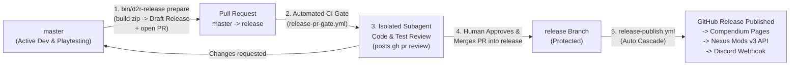

# Castalia — Release Management, Versioning & Multi-Channel Distribution Plan

> **Goal:** Establish a **gated, semi-manual release pipeline** anchored on a protected `release` branch. Weekly changes accumulate on `master`, pass through a formal **GitHub Pull Request + isolated subagent code/test review**, and—once approved and merged into `release`—automatically promote the staged release archive and cascade updates across GitHub Releases, the Castalia Compendium website, Nexus Mods, and Discord.

---

## 1. Branching Model & Semi-Manual Release Gate

Castalia uses a two-branch release model so unfinished mid-week experiments on `master` can never leak into a public release:



### Why `release` Is Protected
Configure **GitHub Branch Protection / Ruleset** on the `release` branch:
* **Require a Pull Request before merging** — direct `git push origin release` is blocked for everyone (including repo admins, or enforced via ruleset).
* **Require status checks to pass (`release-pr-gate`)** — CI verifies version bump, `qa_* == false`, `CHANGELOG.md` entry, and that the staged Draft GitHub Release archive exists and matches `docs/site/latest.json`'s SHA-256.
* **Require conversation resolution before merging** — every finding posted by the isolated review subagent must be addressed and resolved on GitHub before the Merge button unlocks.
* **Merge Strategy:** Use **Merge Commit** (not squash) from `master` → `release` so commit history stays cleanly synchronized and `master` never diverges from `release`.

> [!NOTE]
> **Solo-Owner GitHub Approval Quirks:** GitHub does not allow a PR author to formally `APPROVE` their own PR, and a subagent running under your `gh` token posts under the same GitHub account. Therefore, configure the `release` ruleset to require **PR + status checks + resolved review conversations** (rather than `1 approving review`), while the subagent posts structured reviews via `gh pr review --comment` (or inline comments via `gh api`) and you perform the final human merge click. *(If you later add a dedicated GitHub App / bot token for the reviewer subagent, you can also require `1 approving review`.)*

---

## 2. Isolated Subagent PR Review Protocol

Before any `master` → `release` PR is merged, spawn a **fresh, isolated subagent** (zero shared conversation history from the development session) with a fixed, bounded review mandate:

### Reviewer Subagent Charter
1. **Context Isolation:** Never reuse the coding session's context. The reviewer sees *only* the PR diff (`gh pr diff <PR#>`), repository rules (`AGENTS.md`, `docs/engine/STATS_AND_PITFALLS.md`), and live test output.
2. **Fixed Verification Checklist:**
   * Run the full test suite (`python3 -m unittest -v`) and confirm zero failures.
   * Audit `tools/mod_builder/mod_config.json`: confirm `version` bumped appropriately, `save_schema` / `save_compat` badge accurately reflects any `itemstatcost.txt` / `CSvBits` / skill-tree changes, and **all `qa_*` flags are `false`**.
   * Audit hard Castalia invariants in the diff: no Runewords enabled, zero player elemental/sunder pierce, calc expressions within 248-char limit, no unintended edits to `vanilla-reference/`.
   * Cross-check `CHANGELOG.md` and the Draft Release notes against the actual git diff so player-facing patch notes are accurate and complete.
   * Flag any risky gameplay regressions, undocumented balance shifts, or save-compatibility hazards for weekly co-op players.
3. **Direct GitHub Review Posting:**
   * The subagent posts its structured verdict (`READY TO MERGE` or `CHANGES REQUESTED`) and line-specific findings directly to the GitHub PR via `gh pr review <PR#> --comment --body "..."` (and inline comments where relevant).
4. **Iteration Loop:**
   * Address any findings on `master`, re-run `./bin/d2r-release prepare --refresh` (which rebuilds the `.zip`, updates the Draft GitHub Release assets in-place, and pushes the fix to the PR), and invoke a fresh reviewer pass until all threads are resolved.

---

## 3. Distribution Channels & Platform Strategy

Castalia splits distribution into **three tiers** based on automation support and audience role:

### Tier 1 — Automated Cascade (Triggered by Merging into `release`)

| Channel | Role | Automation Mechanism | Why It Matters |
| :--- | :--- | :--- | :--- |
| **GitHub Releases** (`grant0711/d2r-castalia`) | Canonical binary host & changelog archive | Staged as a **Draft** by `bin/d2r-release prepare`; **promoted to Published** automatically by `release-publish.yml` on merge to `release` | Free, fast CDN, 2 GB asset limit, permanent `releases/latest/download/...` URLs, SHA-256 checksums, and machine-readable API for player auto-updaters. |
| **Castalia Compendium** (`grant0711.github.io/d2r-castalia`) | Live strategy guide, skill calculator, `.d2s` builder & install hub | [`.github/workflows/pages.yml`](file:///home/grant/games/d2r/.github/workflows/pages.yml) (switch trigger from `master` → **`release`** so the live site always matches the published mod!) | Already auto-rebuilt from compiled mod tables by `tools/build_site.py`; hosts `latest.json`, version badge, and direct download button. |
| **Nexus Mods** (`nexusmods.com/diablo2resurrected`) | Primary mainstream D2R mod discovery & download hub | Official **Nexus Mods v3 API** via `Nexus-Mods/upload-action@v1` inside `release-publish.yml` | Largest active D2R modding audience. Updating an existing file chain via `file_id` keeps download history, endorsements, and tracked-mod notifications intact. |
| **Discord** (Castalia Co-Op Server) | Weekly playtest crew coordination & `#releases` feed | Discord Webhook inside `release-publish.yml` | Instant notification to co-op players with version number, save-compatibility badge, changelog highlights, and download links. |

### Tier 2 — Co-Op Ecosystem Integration (Maintained, Low-Touch)

| Channel | Role | Integration Approach |
| :--- | :--- | :--- |
| **D2RLoader (`d2rloader.net`)** | TCP/IP co-op multiplayer loader on current retail D2R (replaces legacy 2.4-locked D2RLAN) | Castalia already runs on `D2RLoader.exe` locally (`bin/d2r-mod`). Ship clean `mods/castalia/castalia.mpq/modinfo.json` + a sample `d2rloader.toml` snippet in `README-INSTALL.txt`, and share Castalia in the D2RLoader community hub/Discord. |
| **D2RMM Compatibility Note** | Clarify installation expectations for Nexus users | **Do not package Castalia as a D2RMM merge script.** Castalia is a full total overhaul (~394k `cubemain.txt` rows, 7-class skill engine, custom sprites) that conflicts with arbitrary D2RMM tweaks. State clearly on Nexus & the Compendium: *standalone `-mod castalia -txt` / D2RLoader install*. |

### Tier 3 — Milestone Discovery Channels (Manual, Minor/Major Releases Only)

| Channel | Role | Update Cadence |
| :--- | :--- | :--- |
| **The Phrozen Keep (`d2mods.info`)** | Historic D2 modding community & veteran showcase | Maintain a single showcase thread linking to the Compendium, GitHub Releases, and Nexus; update only on **Minor/Major** milestones. |
| **ModDB / Reddit (`r/Diablo_2_Resurrected`, `r/diablo2`)** | Broad visibility for major launches | Major milestones only (e.g., `v0.5.0` All-Classes Beta, `v1.0.0` Full Co-Op Launch). Link back to the Compendium & Nexus rather than mirroring weekly zips. |

---

## 4. Versioning Scheme (Save-Aware SemVer)

Castalia uses **Save-Aware Semantic Versioning (`vMAJOR.MINOR.PATCH`)** so weekly co-op players immediately know whether an update is safe to install mid-playthrough:

| Component | Example | Meaning | Co-Op Save Impact |
| :--- | :--- | :--- | :--- |
| **`MAJOR`** | `v1.0.0`, `v2.0.0` | Full launch milestone or **save-breaking schema change** (e.g., `CSvBits` bit-width isolation rollout, `itemstatcost.txt` save-bit shifts). | 🔴 **New Campaign Required** (old `.d2s` saves incompatible). |
| **`MINOR`** | `v0.4.0`, `v0.5.0` | New class overhaul or major system addition (e.g., Sorceress Cold complete, Amazon rework, Dynamic Co-Op Encounters, Expedition Mode). | 🟡 **Save-Compatible; Respec Recommended** (existing characters load cleanly; changed skills may benefit from a respec). |
| **`PATCH`** | `v0.4.1`, `v0.4.2` | Weekly co-op balance tuning, damage/mana tweaks, bugfixes, tooltip fixes, monster scaling adjustments. | 🟢 **Drop-In Save-Compatible** (safe to install between weekly sessions with zero character disruption). |

### Single Source of Truth (`tools/mod_builder/mod_config.json`)
```json
{
  "mod_name": "castalia",
  "version": "0.4.0",
  "save_schema": 1,
  "save_compat": "compatible",
  "d2r_patch": "95032",
  ...
}
```

Running `./bin/d2r-build-mod.py` automatically propagates `version` to **four places**:
1. **In-Game Main Menu Display:** Injects a `TextWidget` (`Castalia v0.4.0`) into `castalia/data/global/ui/layouts/mainmenupanelhd.json` (since `modinfo.json` does not render text on screen) + writes `castalia/castalia_version.json` for updater scripts.
2. **Compendium Website (`docs/site/index.html` & `docs/site/latest.json`):** Stamps `version`, updates the "Download Latest" link, and records the release zip's SHA-256.
3. **Staged Release Archive:** `dist/castalia-v0.4.0.zip` + `dist/castalia-v0.4.0.sha256`.
4. **Git Tag & `CHANGELOG.md`:** Tag `v0.4.0` created on `release` when published.

---

## 5. End-to-End Release Mechanics (Draft Staging → PR Gate → Auto Cascade)

Because `vanilla-reference/` contains copyrighted Blizzard base files and is **not** committed to public GitHub, the mod `.zip` **cannot be compiled from scratch in GitHub Actions**. Instead, Castalia uses **Draft Release Staging**:

### Step 1 — Local Preparation (`./bin/d2r-release prepare <patch|minor|major>`)
1. Verifies clean `master`, `gh` authenticated, and all `qa_*` flags in `mod_config.json` are `false`.
2. Bumps `version` in `tools/mod_builder/mod_config.json` and drafts a new `CHANGELOG.md` section from commits since the last `release` merge.
3. Runs `./bin/d2r-build-mod.py` (compiles `castalia/data/`, injects main-menu version UI, runs `verify.py`, rebuilds `docs/site/`) and `python3 -m unittest -v`.
4. Packages `dist/castalia-vX.Y.Z.zip` (clean `mods/castalia/castalia.mpq/` layout + `README-INSTALL.txt` + `CHANGELOG.md`) and writes `dist/castalia-vX.Y.Z.sha256` + `docs/site/latest.json`.
5. Uploads the archive + checksum to a **hidden Draft GitHub Release**:
   ```bash
   gh release create "vX.Y.Z" dist/castalia-vX.Y.Z.zip dist/castalia-vX.Y.Z.sha256 \
     --draft --target release --title "Castalia vX.Y.Z" --notes-file <notes>
   ```
   *(On subsequent review-fix iterations, `./bin/d2r-release prepare --refresh` overwrites the draft assets via `gh release upload --clobber`.)*
6. Commits `mod_config.json`, `CHANGELOG.md`, and `docs/site/` on `master`, pushes `master`, and opens a PR into `release`:
   ```bash
   gh pr create --base release --head master --title "Release vX.Y.Z" --body-file <notes>
   ```

### Step 2 — Automated PR Gate (`.github/workflows/release-pr-gate.yml`)
Runs automatically on every `pull_request` targeting `release`:
* Confirms `tools/mod_builder/mod_config.json` has `version` strictly greater than the version currently on `release`.
* Confirms all `qa_*` flags in `mod_config.json` are `false`.
* Confirms `CHANGELOG.md` contains a `## [vX.Y.Z]` heading.
* Confirms a **Draft GitHub Release** named `vX.Y.Z` exists with `castalia-vX.Y.Z.zip` and `castalia-vX.Y.Z.sha256` attached, and that its SHA-256 matches `docs/site/latest.json`.

### Step 3 — Isolated Subagent Review & Iteration
* Spawn a fresh reviewer subagent to audit the PR diff, run `python3 -m unittest -v`, and post its review directly on the GitHub PR via `gh pr review`.
* Fix any issues on `master`, run `./bin/d2r-release prepare --refresh`, and re-review until clean.

### Step 4 — Merge into `release` → Automatic Cascade (`.github/workflows/release-publish.yml`)
When you merge the PR into `release`, `release-publish.yml` triggers on `push: branches: [release]` and executes the entire publication cascade automatically:
1. Reads `version` from `tools/mod_builder/mod_config.json` (`vX.Y.Z`).
2. **Promotes the Draft GitHub Release** to public (`gh release edit vX.Y.Z --draft=false --latest --target release`), tagging the exact `release` merge commit.
3. **Downloads `castalia-vX.Y.Z.zip`** from the newly published GitHub Release.
4. **Uploads to Nexus Mods** via `Nexus-Mods/upload-action@v1` (using `NEXUSMODS_API_KEY`, `NEXUSMODS_MOD_ID`, `NEXUSMODS_FILE_ID`).
5. **Posts the release embed to Discord** via `DISCORD_WEBHOOK_URL` (version, save-compatibility badge, changelog highlights, and links to GitHub, Nexus, and the Compendium).
6. Meanwhile, `.github/workflows/pages.yml` (triggered on `push: branches: [release]`) **deploys the updated Compendium website** (`docs/site/`) in lockstep with the published mod.

---

## 6. Weekly Co-Op Playthrough Workflow & Player Auto-Updater

1. **24-Hour Pre-Session Freeze:** Run `./bin/d2r-release prepare patch` the day before game night, run the isolated subagent review, and merge the PR into `release` so players can update ahead of time.
2. **Save-Compatibility Badge:** Every PR, GitHub Release, and Discord post opens with `🟢 Save-Compatible`, `🟡 Save-Compatible (Respec Recommended)`, or `🔴 New Campaign Required`.
3. **2-Second Lobby Version Check:** Everyone reads `Castalia vX.Y.Z` on the D2R main menu before joining the D2RLoader TCP/IP game.
4. **Optional 1-Click Windows Updater (`update-castalia.ps1`):** Checks `https://grant0711.github.io/d2r-castalia/latest.json` against local `mods/castalia/castalia.mpq/castalia_version.json`, downloads the latest `.zip` from GitHub Releases, verifies SHA-256, and cleanly replaces `mods/castalia/castalia.mpq/`.

---

## 7. Implementation Checklist (When Ready to Build)

1. **GitHub Branch & Protection Setup:**
   * Create and push the `release` branch from `master`.
   * Enable GitHub Branch Protection / Ruleset on `release` (require PR, require `release-pr-gate` status check, require conversation resolution).
   * Update `.github/workflows/pages.yml` to deploy from `release` instead of `master` (so the live Compendium stays locked to released versions).
2. **Versioning & In-Game Display:**
   * Add `"version"`, `"save_schema"`, `"save_compat"`, and `"d2r_patch"` to `tools/mod_builder/mod_config.json` and initialize `CHANGELOG.md`.
   * Inject main-menu `TextWidget` (`mainmenupanelhd.json`) + `castalia_version.json` in `tools/mod_builder/` (verify in-game on D2RLoader).
   * Update `tools/build_site.py` to display `version`, link to GitHub Releases `latest`, and emit `docs/site/latest.json`.
3. **Automation Scripts & Workflows:**
   * Implement `bin/d2r-release` (`prepare` + `--refresh` for Draft Release staging and PR creation).
   * Add `.github/workflows/release-pr-gate.yml` (PR validation) and `.github/workflows/release-publish.yml` (Draft promotion + Nexus Mods v3 API + Discord webhook).
   * Configure GitHub Secrets/Variables (`DISCORD_WEBHOOK_URL`, `NEXUSMODS_API_KEY`, `NEXUSMODS_MOD_ID`, `NEXUSMODS_FILE_ID`, `NEXUSMODS_ENABLED`).
4. **Co-Op Teammate Tooling:**
   * Add `update-castalia.ps1` for 1-click Windows updates.
